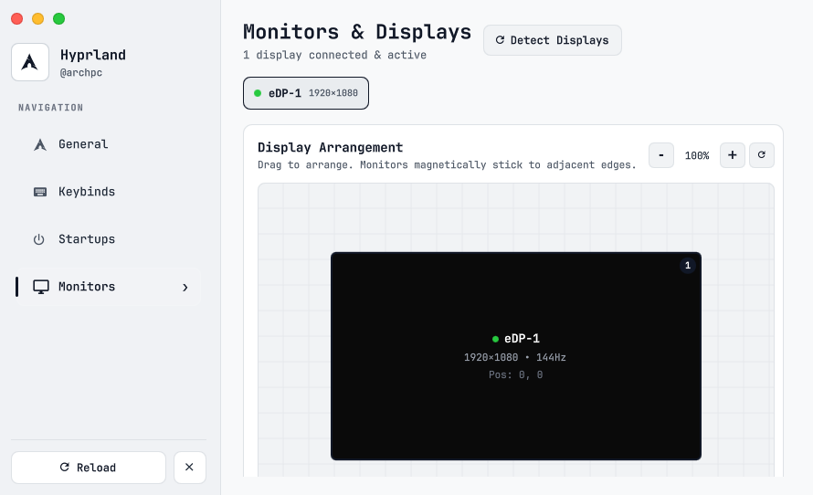
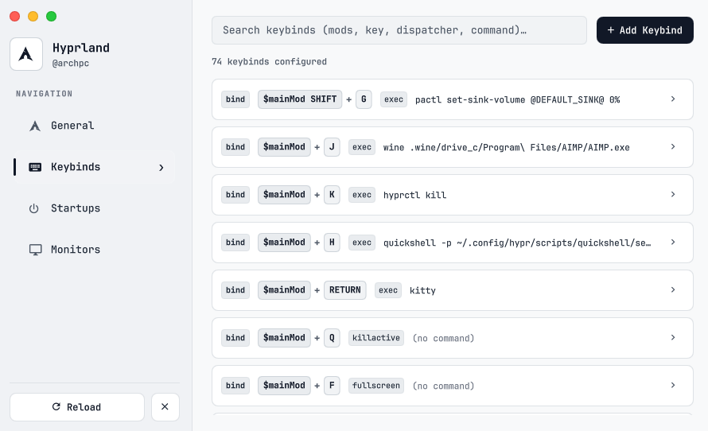
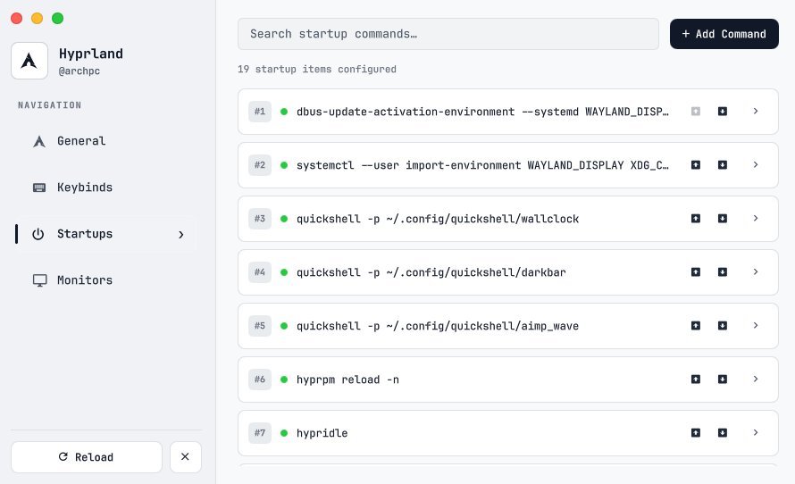

# HyprSettings

<div align="center">

[](https://hyprland.org/)
[](https://quickshell.outfoxxed.me/)
[](LICENSE)
[](https://archlinux.org)

**Declarative GUI settings center and live display manager for modular Lua-configured Hyprland setups.**

[Preview](#preview) &bull; [Features](#features) &bull; [Config Structure](#config-structure) &bull; [Installation](#installation) &bull; [Keybindings](#keybinding-integration)

</div>

<div style="margin: 16px 0; border-top: 1px solid rgba(255,255,255,0.15);"></div>

## Preview

<table width="100%">
  <thead>
    <tr>
      <th width="50%" align="center">Pitch Black</th>
      <th width="50%" align="center">Pure White</th>
    </tr>
  </thead>
  <tbody>
    <tr>
      <td></td>
      <td></td>
    </tr>
    <tr>
      <td></td>
      <td></td>
    </tr>
    <tr>
      <td></td>
      <td></td>
    </tr>
    <tr>
      <td></td>
      <td></td>
    </tr>
  </tbody>
</table>

<div style="margin: 16px 0; border-top: 1px solid rgba(255,255,255,0.15);"></div>

## Features

- **Live System Diagnostics**: Hardware overview with dynamic host, distro, kernel, CPU, GPU detection, and scalable avatar silhouette.
- **Interactive Display Canvas**: Drag-and-drop monitor layout manager with magnetic edge snapping, real-time coordinate updates (`+X, +Y`), resolution, refresh rate, and scaling control.
- **Keybindings Management**: Live inspector and editor for Hyprland key combinations with modifier normalization (``, `SUPER`, `CTRL`, `ALT`, `SHIFT`) and dispatcher mapping.
- **Autostart Process Control**: Declarative interface for managing daemons, background services, status bars, and startup scripts.
- **Dual Monochrome Aesthetics**: Pitch Black (`#0e0e0e`) OLED-optimized dark theme and Pure White (`#f5f5f7`) neutral light theme.
- **Zero-Latency Shell Pipeline**: Built with Quickshell and QtQuick 6 for native hardware-accelerated rendering and direct compositor IPC.

<div style="margin: 16px 0; border-top: 1px solid rgba(255,255,255,0.15);"></div>

## Config Structure

HyprSettings connects directly to modular Lua configuration files under `~/.config/hypr/config/`. When changes are made in the GUI, they are parsed and written directly into these files in real time.

```
~/.config/hypr/
├── config/
│   ├── keybindings.lua   # Hotkeys, modifier definitions & dispatchers
│   ├── autostart.lua     # Startup applications & background daemons
│   ├── settings.lua      # Core compositor options, kb_layout & kb_options
│   ├── monitors.lua      # Display positions, resolutions, refresh rates & scales
│   └── env.lua           # Environment variables & wallpaper directory paths
└── hyprland.lua          # Main entrypoint sourcing modular configs
```

### Supported Directives
- **Keybinds**: `hl.bind("MODS", "KEY", dsp)` syntax in `keybindings.lua`
- **Monitors**: `hl.monitor({ output = "...", mode = "...", position = "...", scale = ... })` in `monitors.lua`
- **Autostart**: `hl.exec("...")` commands in `autostart.lua`
- **Variables**: `hl.env("KEY", "VALUE")` definitions in `env.lua`

<div style="margin: 16px 0; border-top: 1px solid rgba(255,255,255,0.15);"></div>

## Dependencies

| Dependency | Package (Arch Linux) | Purpose |
| :--- | :--- | :--- |
| **Quickshell** | `quickshell-git` | Desktop shell runtime engine |
| **Hyprland** | `hyprland` | Dynamic tiling Wayland compositor |
| **Python 3** | `python` | Config parser & serialization store |
| **Fonts** | `ttf-jetbrains-mono-nerd` | UI typography & glyph icons |
| **Utilities** | `jq`, `util-linux` | Command-line queries and IPC |

<div style="margin: 16px 0; border-top: 1px solid rgba(255,255,255,0.15);"></div>

## Installation

### 1. Clone the Repository

```bash
git clone https://github.com/TheActualWorld/hyprsettings.git ~/.config/quickshell/hyprsettings
```

### 2. Standalone Launch

```bash
quickshell -p ~/.config/quickshell/hyprsettings
```

<div style="margin: 16px 0; border-top: 1px solid rgba(255,255,255,0.15);"></div>

## Keybinding Integration

Add the shortcut to your Hyprland configuration (e.g. `keybindings.lua` or `keybindings.conf`):

```lua
-- Open HyprSettings with Super + H
hl.bind("", "H", hl.dsp.exec_cmd("quickshell -p ~/.config/quickshell/hyprsettings"))
```

Or in traditional `.conf` syntax:

```ini
bind = , H, exec, quickshell -p ~/.config/quickshell/hyprsettings
```

<div style="margin: 16px 0; border-top: 1px solid rgba(255,255,255,0.15);"></div>

## License

Distributed under the MIT License. See [LICENSE](LICENSE) for details.
