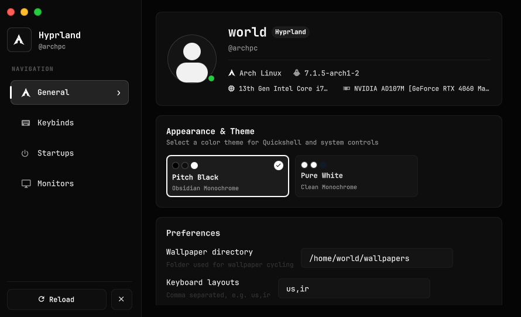
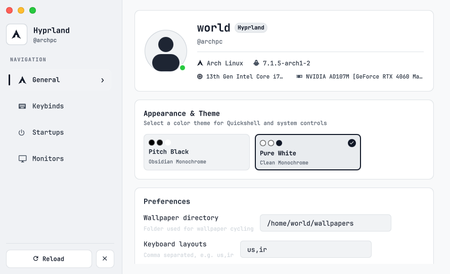
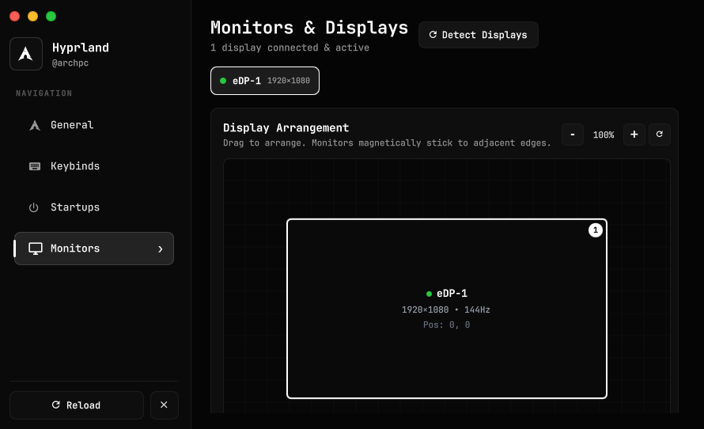
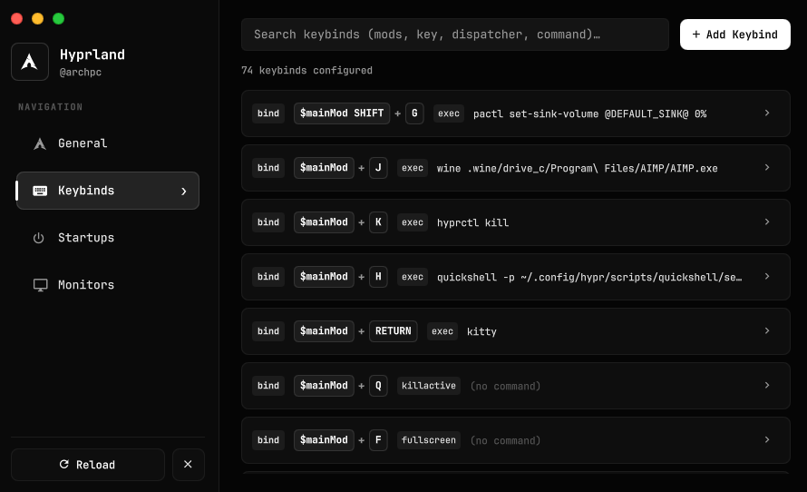
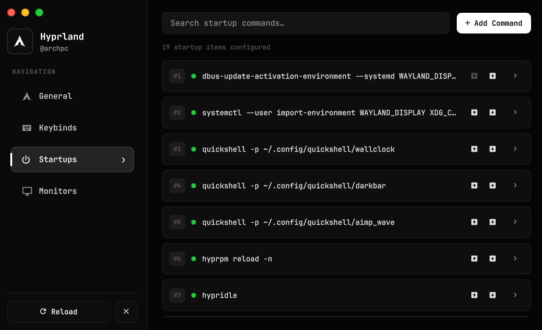

# ⚙️ Wayland Settings

<div align="center">

[](https://wayland.freedesktop.org/)
[](https://quickshell.outfoxxed.me/)
[](LICENSE)
[](https://github.com)

**A modern, declarative GUI control center and settings manager for Wayland compositors.**  
*Native support for Hyprland, Sway, Niri, River, and Wayfire.*

[Features](#-features) • [Screenshots](#-screenshots) • [Installation](#-installation) • [Keybinds](#-compositor-integration) • [Configuration](#-configuration)

</div>

---

## 📸 Screenshots

### Pitch Black & Pure White Themes
<div align="center">
  
  
</div>

### Interactive Display & Monitor Arrangement
<div align="center">
  
</div>

### Keybindings & Autostart Management
<div align="center">
  
  
</div>

---

## ✨ Features

- 🖥️ **Live System Diagnostics & Overview**: Dynamic hardware detection (Host, Distro, Kernel, CPU, GPU, Session DE) with dynamic vector silhouette styling.
- 📐 **Interactive Sticky Display Manager**:
  - Live drag-and-drop monitor canvas with magnetic edge snapping.
  - Real-time coordinate inspection (`+X, +Y`), resolution, refresh rate, and scale factors.
  - High-contrast visual specs border cards.
- ⌨️ **Keybind Inspector & Configurator**:
  - Declarative keybinding viewer and editor.
  - Automatic modifier normalization (`$mainMod`, `SUPER`, `CTRL`, `ALT`, `SHIFT`).
  - Native dispatcher mapping for exec, workspace navigation, window cycling, and floating.
- 🚀 **Autostart Application Control**:
  - Manage startup daemons, status bars, notification daemons, and wallpaper engines.
  - Instant toggle and exec parameter tweaking.
- 🎨 **Minimalist Dual Aesthetic Engine**:
  - **Pitch Black (`#0e0e0e`)**: Deep OLED-optimized true dark mode with subtle gray border hierarchy.
  - **Pure White (`#f5f5f7`)**: Clean, crisp high-contrast light mode with soft neutral accents.
- ⚡ **Zero-Latency Declarative Performance**: Powered by Quickshell and QtQuick 6 — renders natively with hardware-accelerated compositor frame rates.

---

## 📦 Dependencies

Ensure the following packages are installed on your system:

| Dependency | Package (Arch Linux) | Description |
| :--- | :--- | :--- |
| **Quickshell** | `quickshell-git` (AUR) | High-performance Wayland desktop shell engine |
| **Python 3** | `python` | Config synchronization store bridge |
| **Hyprland / Compositor** | `hyprland` / `sway` / `niri` | Supported Wayland compositor |
| **Fonts** | `ttf-jetbrains-mono-nerd` | Vector glyphs and typography |
| **Tools** | `jq`, `util-linux` | Command-line utilities for system queries |

---

## 🚀 Installation & Usage

### 1. Clone the Repository

```bash
git clone https://github.com/TheActualWorld/wayland-settings.git ~/.config/quickshell/wayland-settings
```

### 2. Launch Standalone

Test-run the settings interface immediately with Quickshell:

```bash
quickshell -p ~/.config/quickshell/wayland-settings
```

---

## ⌨️ Compositor Integration

Bind the settings interface to your preferred hotkey (e.g. `Super + H`):

### Hyprland (`hyprland.conf` or `hyprland.lua`)

```ini
# Open Wayland Settings GUI
bind = $mainMod, H, exec, quickshell -p ~/.config/quickshell/wayland-settings
```

### Sway (`~/.config/sway/config`)

```ini
bindsym $mod+h exec quickshell -p ~/.config/quickshell/wayland-settings
```

### Niri (`~/.config/niri/config.kdl`)

```kdl
binds {
    Mod+H { spawn "quickshell" "-p" "~/.config/quickshell/wayland-settings"; }
}
```

---

## ⚙️ Configuration & Architecture

```
wayland-settings/
├── shell.qml               # Main window container & header navigation
├── Theme.qml               # Centralized Pitch Black & Pure White color tokens
├── qmldir                  # QtQuick module registration
├── components/             # Reusable UI primitives (Cards, Switches, Buttons)
├── pages/
│   ├── GeneralPage.qml     # Hardware specs, theme selector & profile
│   ├── MonitorsPage.qml    # Interactive canvas with sticky snapping & live coordinates
│   ├── KeybindsPage.qml    # Hotkey list & dispatcher inspector
│   └── StartupsPage.qml    # Autostart process management
├── services/
│   ├── SysInfo.qml         # Live hardware & session detection
│   ├── Monitors.qml        # Real-time display queries
│   └── SettingsStore.qml   # Reactive store connector
└── lua_config_store.py     # Python bridge for reading and serializing configurations
```

---

## 📄 License

Distributed under the **MIT License**. See [`LICENSE`](LICENSE) for details.

---

<div align="center">
  <sub>Built for the Wayland Linux desktop community.</sub>
</div>
